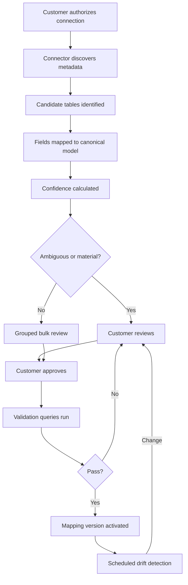
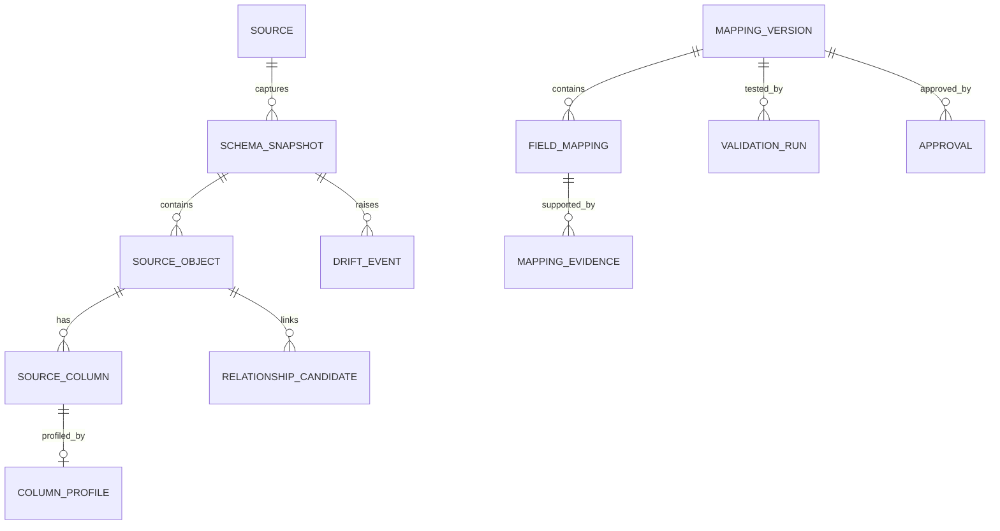

# AI Schema Discovery and Mapping

Audit date 2026-10-31, commit `647ef7b`. Labels: **[V]** verified · **[R]** recommendation · **[A]** assumption.

## 1. Can the current system handle unknown schemas?

**No. It runs well on schemas a person has already mapped. It cannot discover one.**

| Capability | State | Evidence |
|---|---|---|
| Canonical model | **Strong**: 11 datasets with types, roles, sensitivity, units | `canonical/catalog.py` [V] |
| Different physical names per tenant | **Working**: `MATNR` vs `item_code` | `config/tenants/demo-*.yaml`, `mapping/resolver.py` [V] |
| Value maps (`ROH` → `RAW`) | **Working**, unmapped codes reported | `resolver.py:141-149` [V] |
| Extension attributes | **Working**, but cannot be cost-tagged | `tenancy/models.py:78-81` [V] |
| Column drift on mapped tables | **Working** | `admin/service.py:46-109` [V] |
| Unmapped columns on mapped tables | Listed for review | same [V] |
| Table/view discovery | **Unused.** `list_objects()` exists; nothing calls it | grep [V] |
| PK, FK, comments | **Absent.** `ColumnInfo` has name, type, nullable only | `connectors/base.py:19-23` [V] |
| Value profiling, sample analysis | Absent | ISSUES #15 |
| LLM or embedding mapping suggestions | Absent | [V] |
| Confidence scoring, approval workflow | Absent | ISSUES #15 |
| Mapping versions | Git history only | `02-architecture/MAPPING.md` [V] |
| Join cardinality checks | **Absent, and it silently corrupts totals** | LA-05 [V] |

The `/admin` "Connection and schema" screen is a drift check, not discovery.

The principle already in the code is correct and must stay: *"Nothing is ever guessed from column names"* (`mapping/resolver.py:3-4`). Discovery should produce **candidates**; only people activate mappings.

## 2. Onboarding flow



No path reaches activation without a named person's approval. "High confidence" reduces review effort but never removes the approval.

## 3. Signals, from strongest to weakest

| # | Signal | Use | Needs row access? |
|---|---|---|---|
| 1 | **Knowledge pack** (SAP dictionary, Odoo model names) | `MARD.LABST` is unrestricted stock by definition | No |
| 2 | Database metadata: tables, views, columns, types | Filter what is possible | No |
| 3 | Primary keys, unique indexes | Grain | No |
| 4 | Foreign keys, naming patterns | Relationships | No |
| 5 | Comments; SAP field labels; BI models | Business meaning | No |
| 6 | Query history, view definitions (if allowed) | What the customer actually joins | No |
| 7 | **Approved profiling**: distinct counts, null rate, min/max, patterns | Tests hypotheses | Aggregates |
| 8 | Value-overlap between columns | Infers undeclared relationships | Aggregates, or hashes |
| 9 | Embedding similarity on names and descriptions | Generates candidates | No |
| 10 | LLM reasoning over metadata | Explains and ranks candidates | No, but needs approval |
| 11 | Sample values | Last resort, governed | Yes |

Run in order, and **stop as soon as the evidence is sufficient**. Most SAP mappings should never touch an LLM.

**Where the LLM belongs:** ranking candidates, drafting human-readable explanations, and proposing mappings for unfamiliar custom tables. Output is schema-constrained (`canonical_field`, `reason`, `cited_signals`) and is always a suggestion. Under Model B with no external AI, signals 1–9 still work. Sending metadata to an external LLM needs the same approval as data, because metadata is sensitive.

**Embeddings:** useful for abbreviations and multiple languages, weak for cryptic codes. Treat them as a candidate generator, not as evidence of correctness.

## 4. Confidence

Keep it explainable. The weights below are a starting point and **must be calibrated** on labelled mappings. Show the evidence to the reviewer, not only a number.

```text
Hard gates (any failure blocks automatic ranking as "strong"):
  type compatible · grain test passes · relationship cardinality as declared

score = 0.40 authoritative source (knowledge pack / declared FK)
      + 0.25 profile match (patterns, ranges, null rate, cardinality)
      + 0.20 semantic match (labels, comments, embeddings)
      + 0.15 corroboration (BI model, view definition, query history)
```

| Band | Meaning | Treatment |
|---|---|---|
| Strong | Authoritative evidence and tests pass | Reviewed as a group |
| Likely | Good evidence, no authority | Reviewed individually |
| Uncertain | Conflicting or thin | Must be resolved |
| Material (any score) | Quantity, price, currency, UoM, scope key, cost sensitivity | **Always individual sign-off** |

## 5. Your questions

| Question | Design answer |
|---|---|
| Two columns with similar names but different meanings? | Names never decide. Compare labels, type, profile, and table grain. Example: `MEINS` (base unit) vs `BSTME` (order unit). If still tied, ask the reviewer with a side-by-side view and record the rationale |
| Multiple inventory tables? | Present them as candidates with grain and coverage: batch stock, plant stock, consignment, a snapshot table, a history table. Reconcile each against a customer report. The customer designates one authoritative source per dataset; others stay optional |
| Relationships not explicitly defined? | Infer candidates by name and value overlap, then **test cardinality** (see below). Never activate a join on overlap alone |
| How to identify stock quantity? | Numeric decimal measure at item+location grain; sums reconcile to a customer total; a unit column exists; label evidence supports it. Reconciliation is the deciding test, not the name |
| Correct warehouse and item relationships? | Test: all stock item keys resolve to the item table (orphans reported), and item key is unique there. Verify composite keys (material + plant). Confirm warehouse-to-department with the customer |
| Schema changes? | Scheduled drift check (exists for mapped tables). Classify: new column → info; type change, rename, removed column → dependent metrics suspended with a clear message, not wrong answers |
| Customer corrects a mapping? | Edit in review UI → creates a new version → validation runs → second approver → atomic activation. Old version retained and restorable. Cached results invalidated |

**Tests that must exist (LA-05).** The repo's catalog declares joins as many-to-one (`canonical/catalog.py:60-65`) and nothing checks them. In a scratch copy of synthetic data, adding one duplicate lot number added **USD 63,990.61 (2.31%)** to a total with no warning. SAP batch numbers are commonly unique per material or per material/plant, and `stock_balance → lot` joins on `lot_id` alone (`catalog.py:212`). So activation must run:

```sql
-- Target key must be unique, otherwise the join multiplies rows. Expected: 0 rows.
SELECT lot_id, COUNT(*) FROM <lot_source> GROUP BY lot_id HAVING COUNT(*) > 1;

-- Totals through each approved join must equal the total without it.
SELECT SUM(value) FROM <stock>;                                     -- A
SELECT SUM(value) FROM <stock> s LEFT JOIN <lot> l ON ...;          -- must equal A
```

## 6. Metadata registry

Replace YAML-as-state with database-held, versioned records. YAML remains a valid export format and a good code-review artefact.



| Table | Key columns |
|---|---|
| `source` | tenant, type, capabilities, connection reference (never a secret) |
| `schema_snapshot` | source, captured_at, content hash |
| `source_object` | schema, name, kind, row estimate, comment, included flag |
| `source_column` | name, type, nullable, pk flag, comment, label |
| `column_profile` | null rate, distinct estimate, min/max (if approved), pattern, `sampled` flag, approved_by |
| `relationship_candidate` | from/to columns, declared or inferred, measured cardinality, orphan rate |
| `mapping_version` | version, status (`draft`, `in_review`, `active`, `retired`), parent, hash |
| `field_mapping` | canonical field, source expression, value map, sensitivity, confidence band |
| `mapping_evidence` | signal type, summary, source (`pack`, `metadata`, `profile`, `llm`), model id if used |
| `approval` | approver, role, decision, comment, timestamp |
| `validation_run` | test, result, expected vs actual, ran_at |
| `drift_event` | type, object, severity, affected metrics, status |

**Every result's provenance should carry `mapping_version`.** It is missing today. Without it, nobody can later prove how a historic figure was produced.

## 7. Example mapping

```yaml
# Illustrative. Not a format the application reads today.
mapping_version: 7
status: active
source: acme_dw
approved: { by: j.smith, role: inventory_controller, second: a.khan, at: 2026-11-02T10:14:00Z }

datasets:
  stock_balance:
    source: inv.v_stock_by_location
    grain: [item_id, warehouse_id, location_id, lot_id, stock_status]
    authoritative: true
    fields:
      item_id:      { column: MATNR, confidence: strong, evidence: [sap_pack:MARD-MATNR] }
      warehouse_id: { column: WERKS, confidence: strong, scope_key: true }
      quantity:
        column: LABST
        unit_field: uom
        confidence: strong
        material: true          # individual sign-off regardless of score
        evidence: [sap_pack:MARD-LABST, reconciled:MB52@2026-10-30]
      valuation_price:
        expression: "VERPR / PEINH"
        sensitivity: cost
        currency_field: currency
        material: true
      warehouse_name: { column: NAME1, confidence: likely, reviewer_note: "plant name, not vendor name" }
    joins:
      lot:
        on: [[item_id, item_id], [warehouse_id, warehouse_id], [lot_id, lot_id]]
        cardinality: many_to_one
        verified: { unique_target: true, totals_preserved: true, run: 4412 }
    value_maps:
      stock_status: { "1": unrestricted, "2": quality_inspection, "3": blocked }

validation:
  - { test: total_reconciles, report: MB52, tolerance: "0.01", status: pass }
  - { test: orphans, dataset: item, max_rate: "0.001", status: pass }
```

## 8. Knowledge packs

A versioned pack for each source family contains known objects, fields, labels, seed value maps and analysis caveats.

SAP pack should encode, for example:

- **Composite identities:** a material document line is `MBLNR` + `MJAHR` + `ZEILE`. The demo maps `txn_id` to `MBLNR` alone, and `costing/engine.py:55-61` then drops repeats as duplicates, which would silently discard real lines (LA-17).
- **Movement types:** `BWART` codes such as reversals need rules, or dormant analysis counts cancelled issues as activity.
- **Price:** `VERPR` applies per `PEINH`; the existing importer handles price unit correctly.
- **Valuation:** moving vs standard price (`VPRSV`), and split valuation (currently refused, ISSUES #23).

## 9. Delivery order

1. Capture metadata (`discover()`, PK/FK/comments) and persist snapshots.
2. Validation harness with grain, orphan, join and reconciliation tests. **Highest value; do this first.**
3. Mapping versions and approval.
4. SAP pack for the existing client layout.
5. Review UI.
6. Aggregate profiling with approval.
7. Embeddings, then LLM suggestions, only for what remains unmapped.

Doing this in reverse would be the expensive mistake: an impressive AI demo with no way to prove a mapping is right.
