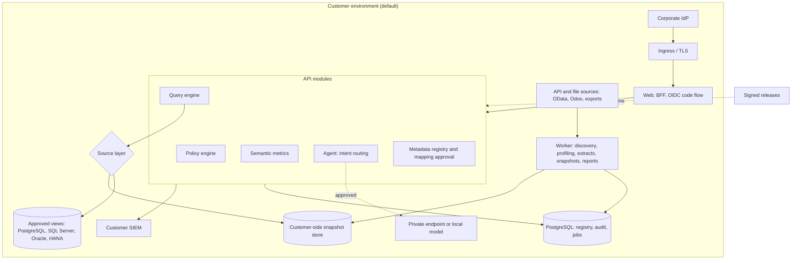

# Architecture Review

Audit date 2026-10-31, commit `647ef7b`. Everything under "Target" is a recommendation; nothing is built.

## 1. Verdict

**Keep the modular monolith.** ADR-0001 was the right decision, and the module boundaries are real. The main architectural problem is not structure. It is that the design assumes a queryable SQL source, static configuration, and one process, none of which survives the first enterprise customer unchanged.

## 2. What is right

| Decision | Why it holds up |
|---|---|
| One governed path to data | Permissions, audit and provenance are not scattered |
| LLM cannot write SQL (ADR-0002) | Removes a whole risk category and survives bad model behaviour |
| Small canonical model driving validation | Safety rails come from metadata, not per-screen code |
| Per-tenant connector | Prevents accidental cross-tenant access |
| Fail-closed audit | Strong default |
| Decimal strings end-to-end | Correct, apart from AVG (LA-14) |
| Control-total gate on import | Better than most commercial pipelines |
| Honest status docs and refusal behaviour | Rare and commercially valuable |

## 3. Weaknesses

| # | Weakness | Evidence | Consequence |
|---|---|---|---|
| 1 | **Connector contract is SQL-only** | `connectors/base.py:55` | No path for OData, Odoo or Cognos without redesign |
| 2 | **Single type allowed** | `tenancy/models.py:30` | No customer can connect |
| 3 | **Config is state** | YAML; restart to change | Onboarding, approval and versioning all blocked; one mapping error stops the API for all tenants, because any invalid file aborts start-up |
| 4 | **Cardinality is asserted, not checked** | `catalog.py:60-65` | Silent wrong totals |
| 5 | **Two query paths** | Plans vs hand-built `Select`s | Scope logic duplicated across 3+ analyses |
| 6 | **Analyses load rows into Python** | ABC, cost comparison, concentration | Row caps turn into feature limits |
| 7 | **Everything is synchronous** | No job system | Long reports, schema scans and refresh will tie up workers |
| 8 | **Per-process state** | Insights, tenant meta, default limiter | Inconsistent across replicas |
| 9 | **Web bound to API at build** | `next.config.ts:5` | One image per environment |
| 10 | **Browser auth assumes the dev cookie** | `proxy.ts:19` | Production cannot sign in |
| 11 | **Rules and messages in Python** | `providers.py` regexes | Coverage grows by hand; no semantic layer |
| 12 | **DuckDB `Connector` semantics leak** | Timer + `interrupt()` | Cancellation differs per driver |

## 4. Unnecessary complexity

The repository is mostly restrained. A few items are ahead of their value:

- **Redis limiter and two AI adapters** were built before any deployment or live test. Harmless, but they increase surface area.
- **Very fine UI work** (Lens, motion, command palette) preceded connectors. It has demo value and no enterprise blocker removed.
- **Docs volume:** 3,767 lines, partly stale (LA-24). The logging protocol is admirable, but `README.md` still says "Milestone 1". Generate status from evidence, or keep a single page.
- **AGENT_DESIGN lists unbuilt tools** in the same format as built ones.

## 5. Should anything be a separate service?

| Candidate | Split? | Reason |
|---|---|---|
| Web vs API | Already split | Fine |
| Auth, reporting, metadata as services | **No** | No independent scaling or ownership need |
| Connector agent | **Later, yes** | Only when a hosted control plane exists: it must physically run elsewhere. A real reason |
| Background worker | **Yes, soon, same codebase** | Different runtime profile (schema scans, extracts, scheduled reports, snapshots). Same image, different command |
| LLM gateway | Module first | Separate only if local inference needs its own hardware |
| Inference server | **Separate process** when local models arrive | GPU and lifecycle differ |

**Rule:** split for a different trust boundary, runtime profile, or deployment location. Not for tidiness. Microservices would add operational load exactly where a customer-hosted product can least afford it.

## 6. Target architecture

Hosted later: control plane + the same data plane run as an outbound-only agent, with no change to the query engine.

### Target changes, in dependency order

1. **Correctness guards.** Result checks; join verification.
2. **Source abstraction** with capabilities; `SqlSource` and `ExtractSource`.
3. **Persistent registry** replacing YAML as state (YAML stays for import and export).
4. **Unified analysis path:** one function adds scope to any selectable, and hand-built queries must go through it. Consider a query-object type that cannot execute without a scope stamp.
5. **Push analytics into SQL.** ABC and Pareto via window functions in the warehouse or snapshot store.
6. **Worker + job table**: PostgreSQL-based queue is enough at this scale. Avoid adding a broker until needed.
7. **BFF authentication.**
8. **Packaging:** Helm/Terraform, runtime API origin, signed images.
9. **Observability:** OpenTelemetry metrics and traces with no data values.

## 7. Questions a CIO, CISO, DBA or CFO will ask

| Audience | Question | Today's honest answer |
|---|---|---|
| CIO | What must we run? | Containers + PostgreSQL. No deployment tooling yet |
| CISO | What data leaves? | Depends on AI mode. Needs intent-only and a real disclosure log |
| CISO | Pen test? | None |
| DBA | What load will you add? | Unmeasured. 52 queries for a dashboard is a concern; no cost control yet |
| DBA | What exact grants? | Views + `SELECT`; connectors unbuilt |
| CFO | Why trust these figures? | Reconciliation tool exists; must pass against your report. Today, LA-02 and LA-05 must be fixed |
| Inventory | Does it match MB52? | Yes for the sample tested, by control totals |

## 8. Open architectural questions

| Question | Recommended position |
|---|---|
| Millions of stock rows? | Push aggregates down; paginate with keysets; pre-aggregate in the customer's warehouse |
| Warehouse unavailable? | Clear per-widget state; last known result only when labelled with time |
| Two sources disagree? | One authoritative source per dataset; show discrepancies as findings, never merge silently |
| Which is authoritative? | Customer decides per dataset; recorded in the mapping version |
| Customer-specific rules? | Versioned tenant config, tested per release; no forks |
| Customer revokes access? | Queries fail immediately with a clear state; purge per contract; event logged |
| Upgrades without interruption? | Rolling; expand-then-contract migrations; compatibility across one version |
| Several source systems for one tenant? | Needs a master-data key strategy (item crosswalk). Not supported: one connector per tenant today |
| How to price hosted vs customer-hosted? | See `PRODUCT_ROADMAP.md` |
