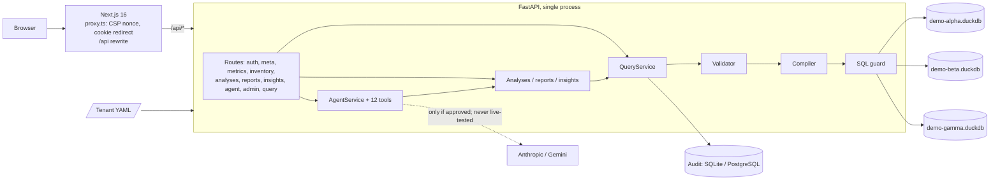
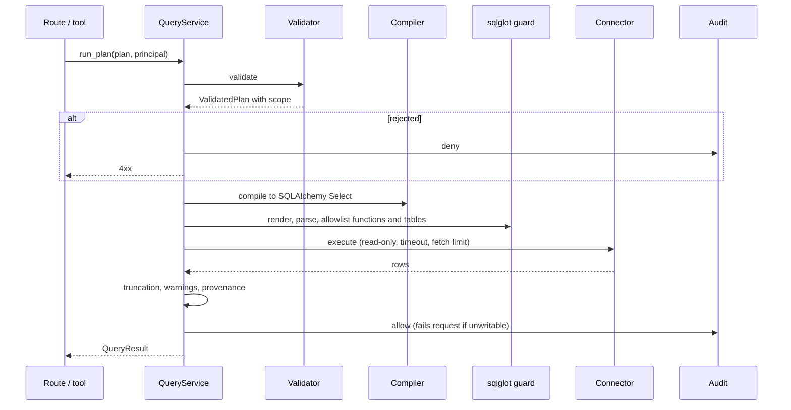
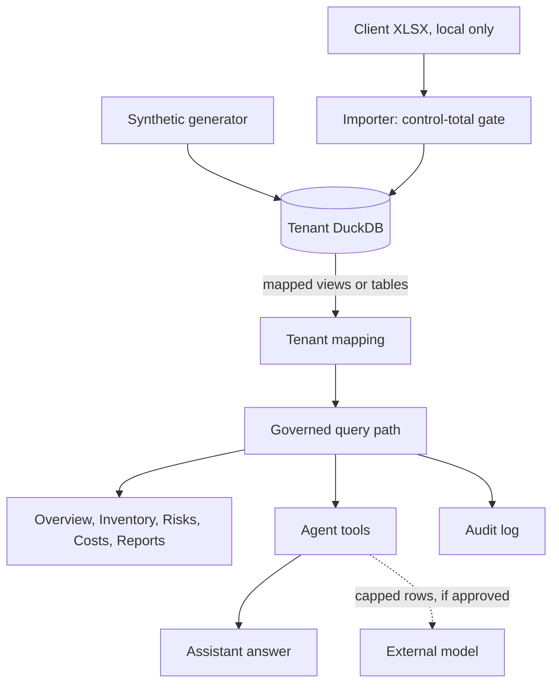
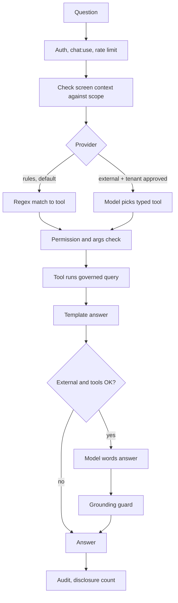

# Current Architecture

What exists at commit `647ef7b` (2026-10-31), traced from code and running behaviour. Critique and target state are in [ARCHITECTURE_REVIEW.md](ARCHITECTURE_REVIEW.md).

## 1. Shape

A modular monolith in two deployables: a Next.js web app and one FastAPI service. Data lives in per-tenant DuckDB files; audit lives in SQLite (development) or PostgreSQL. Nothing runs asynchronously.

Scale of the code: 5,315 Python statements in `services/api/src`, 48 TypeScript source files in `apps/web/src`, and 3,767 lines of Markdown docs.

## 2. Your ten questions

### 2.1 How a user accesses the application

Browser opens the Next.js app on port 3000. `proxy.ts` runs on each page request, sets a per-request nonce CSP, and redirects to `/login` if there is no `lumiant_session` cookie. Login lists demo users. **There is no password.** In OIDC mode the same redirect traps users (LA-01).

### 2.2 How authentication works

| Mode | Mechanism | State |
|---|---|---|
| `dev` | `POST /api/auth/dev-login` with a username issues an HS256 JWT in an httpOnly, SameSite=Lax cookie. Secret is random per process unless configured. Roles are re-read per request | Working; default mode |
| `oidc` | `Authorization: Bearer` validated against tenant JWKS, issuer, audience; algorithms restricted to asymmetric. Groups map to roles and warehouses in YAML | API verified with local keys only. **Browser cannot reach it** |

`current_principal` (`auth/deps.py:26`) builds the `Principal`: user, tenant, roles, permissions, warehouse scope.

### 2.3 How the frontend talks to the backend

Same-origin fetch via `lib/api.ts`, proxied by a Next rewrite to `API_ORIGIN`, fixed at build time. POSTs carry `X-Requested-With: lumiant` as a CSRF check. React Query caches; state sits in URLs (filters), React Query (server state) and a small external store (Analyst). The assistant streams server-sent events. Money stays as strings until display.

### 2.4 How inventory data is obtained

Three ways, none a live system:

| Path | Source | Writes |
|---|---|---|
| `lumiant-synthetic generate` | Deterministic generator | `data/synthetic/*.duckdb` |
| Twin | Generated XLSX through the real importer | `demo-gamma.duckdb` |
| `lumiant-ingest sap` | Real client XLSX on one machine (ADR-0008) | `var/private/` (git-ignored), not in repo |

### 2.5 Canonical model

`canonical/catalog.py` defines 11 datasets. Each field declares type, role (key, dimension, measure, date, attribute), sensitivity, scope key, unit and currency companions, and computed form. `stock_value` is `quantity × valuation_price`. These flags drive validation. It is a good, deliberately small semantic layer.

### 2.6 Customer-specific mappings

`config/tenants/<id>.yaml`, Pydantic-validated at start (unknown keys rejected). Each maps canonical fields to physical columns, with optional attributes and value maps. `TenantMapping` turns this into SQLAlchemy tables. A field not mapped simply does not exist for that tenant. Changes need a restart.

### 2.7 How queries are validated

`PlanValidator.validate` (`query/validator.py:125`):

1. Tenant matches.
2. Dataset and fields exist; joins approved.
3. Aggregation legal for the field type.
4. Filters type-coerced; explicit out-of-scope warehouse → 403.
5. Currency and unit auto-added as grouping.
6. Cost fields checked against `cost:read`.
7. Warehouse scope filter injected.
8. Order limited to selected columns; row limit enforced.

### 2.8 SQL generation and execution

Values are bound parameters, except value-map constants, which come from validated config. Analyses that need CTEs build a `Select` by hand and join at `execute_select`, so they get guard, timeout and audit, **but not the validator**; they add scope themselves.

### 2.9 How results reach the frontend

`QueryResult.payload()` returns `{data, columns, provenance, warnings, page, summary}`. Decimals become strings, dates ISO. Provenance names source objects, physical columns, filters, injected scope, as-of time, duration, metric rule, and SQL for `query:view_sql`. The UI renders a "Source" slip from it.

### 2.10 Audit logging and permissions

Each data access writes `audit_event`: tenant, user, action, dataset, field names, decision, reason, row count, duration, request id. No values. A failed write aborts the request (fail closed), except where insight rules catch it. Viewable with `audit:read`. Permissions are 9 strings; each route declares its needs, and tenant YAML maps roles to them.

## 3. Current data flow

## 4. Current query execution for a chat question

## 5. Frontend

| Area | Design |
|---|---|
| Routing | App Router; thin pages under `(app)/` delegating to `components/*` |
| Shell | Rail nav, command bar, Ctrl+K palette, keyboard shortcuts |
| Data | React Query hooks in `lib/hooks.ts` |
| Charts | Recharts with a validated palette |
| Analyst | Persistent dock, Lens selection, streamed steps, pins in `localStorage` |
| Security | Nonce CSP, no raw HTML, optional hiding, server-side truth |
| Pages | Overview, Explore, Inventory, Risks, Costs, Assistant, Reports, Admin |

## 6. Infrastructure

| Area | State |
|---|---|
| Containers | Two Dockerfiles; non-root; API health check. Compose is a demo stack |
| CI | GitHub Actions: ruff, mypy, pytest, pip-audit, eslint, tsc, vitest, pnpm audit, e2e, Postgres/Redis, Docker smoke. Green on `647ef7b` |
| Migrations | Alembic; one migration (`audit_event`); auto-run by default |
| Observability | JSON logs with request id. No metrics or tracing |
| Secrets | Environment only |
| Deployment | **Never run in any environment.** Docs say so |
