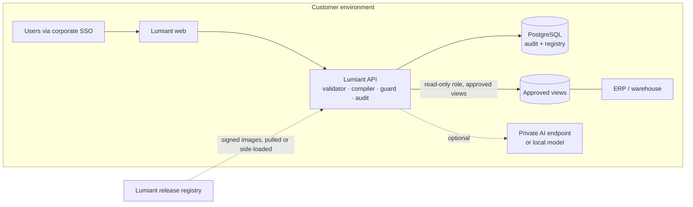
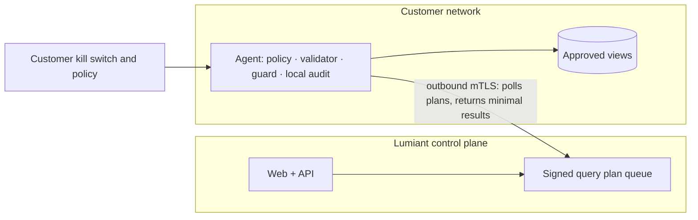
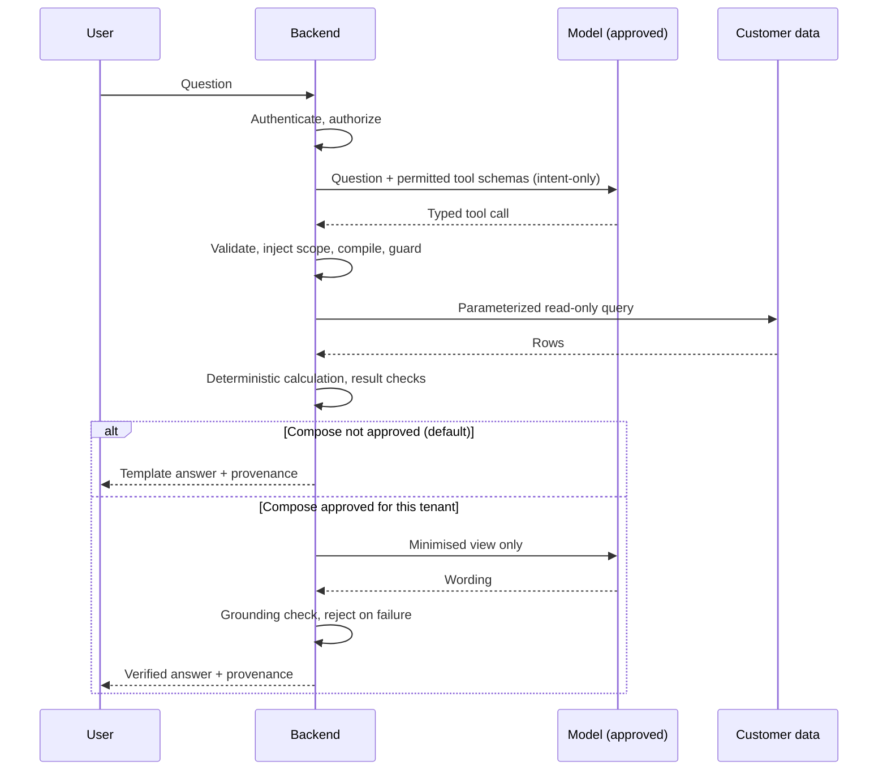

# Enterprise Data Access and Trust

Audit date 2026-10-31, commit `647ef7b`. Finding IDs (`LA-nn`) are defined in [CODEBASE_AUDIT.md](CODEBASE_AUDIT.md).

**Evidence labels:** **[V]** verified in code or by running it · **[R]** recommendation, not built · **[A]** assumption · **[X]** external source, re-check before contractual use.

> Nothing here is legal advice. Every customer-facing commitment below needs review by counsel and validation against the deployed configuration and provider contracts.

## 1. The answer in brief

**Deploy Lumiant inside the customer's environment first.** The current product is one API and one web app with no shared service dependency, so the whole stack can run inside a customer's network or cloud account with far less engineering than a split agent/SaaS architecture.

| Decision | Recommendation |
|---|---|
| Default for the first customers | **Model B** (whole stack in the customer's cloud or network) with read-only access to approved views |
| Default AI posture | Built-in matching, then **intent-only** AI: the model sees the question, never the results |
| Highly regulated | Model B fully isolated, no control plane, signed offline upgrades, Model E local inference or AI off |
| Limited data sharing allowed | Model A + C: customer-side agent, hosted UI, aggregates only |
| External AI prohibited | Built-in matching and/or Model E. If neither meets a request, say the feature is unavailable |
| Bulk replication | Never the default. Model G only by explicit choice |

The most valuable technical change is small: make result-free AI a supported mode. `agent/service.py` already produces a deterministic template answer and only overwrites it when `compose()` succeeds, so skipping `compose()` means no inventory result reaches a model. [V for the code path; R for the mode]

## 2. What is true today

| Control | State | Evidence |
|---|---|---|
| Read-only source access | **DuckDB files only.** Enforced by `read_only=True` | `connectors/duckdb_connector.py:27` [V] |
| Real database or ERP connection | **None.** Config accepts only `duckdb`; `secret_ref` is never read | `tenancy/models.py:30-33`, `connectors/registry.py:30-32`, probe 17 [V] |
| External AI approval | One boolean per tenant, default off | `tenancy/models.py:135-138`, `agent/providers.py:556-561` [V] |
| Live external AI | **Never exercised.** Tested with fake clients only | ISSUES #13 [V] |
| Results sent to a model | Up to 20 rows per tool, first block, with descriptions and values; nothing masked | `providers.py:405-411`, probe 7 [V] |
| Disclosure log | Row count and provider name only, not what was sent | `service.py:262-272`, probe 7 [V] |
| Warehouse scope | Injected server-side; resisted `not_in` and OR attempts | `query/validator.py:284-294`, probe 4 [V] |
| Cost permission | Enforced on selects, filters and aggregates | `validator.py:277-282`, probe 4 [V] |
| Customer-managed keys, residency, DR, encryption at rest | **Not implemented**; platform-dependent | [V: absent] |
| Pen test, SOC 2, ISO 27001 | **None evidenced.** Do not imply any | [V: absent] |

Three documented promises do not match the code and must be fixed or corrected before a customer reads them (LA-07):

| Document says | Code does |
|---|---|
| `THREAT_MODEL.md` T-12: "sensitive fields stripped" | `model_view` strips nothing; a user with `cost:read` sends values to the model |
| `AGENT_DESIGN.md` §5: disclosure log records "exactly what was sent" | It records a count |
| `AGENT_DESIGN.md` §5: "≤ 50 rows" | The cap is 20, per tool (more conservative, but the documents disagree) |

## 3. Deployment models

### Model A: customer-hosted connector

A small agent runs inside the customer network, opens outbound-only connections to a Lumiant control plane, and runs queries against approved views.

- **Design:** the agent holds mapping, validator, compiler, guard, connector and local audit. These are existing Python modules, so it reuses code rather than duplicating it. The control plane sends a **signed query plan, never SQL**, and the agent revalidates it against a **customer-owned local policy** (allowed datasets, fields, row limits, kill switch). [R]
- **Install:** signed container or Windows service; 2 vCPU / 2 GB is the repo's starting API figure and is unvalidated for an agent [A]. Access to the warehouse on its native port and to HTTPS egress for one hostname.
- **Connectivity:** outbound 443 only, no inbound ports. Mutual TLS with per-agent certificates, rotated automatically, enrolled with a one-time token. Must work through a proxy with TLS inspection, which is common and often breaks mutual TLS. [R]
- **Identity:** dedicated read-only service account stored in the customer's vault or OS-protected store. Lumiant staff never see it. [R]
- **Updates:** customer-selectable ring (auto, or approve each version), signature checked by the agent, automatic rollback on failed health check, previous version retained. Query path should tolerate one version of skew. [R]
- **Monitoring:** heartbeat and error codes to the control plane, never row data. Local audit log exported to the customer's SIEM.
- **Failure recovery:** if the agent is offline the UI shows "source unavailable" with last-success time. It must never show stale values as current. No queued writes exist because the system is read-only.
- **Control plane or isolated?** Support both. A hosted control plane suits most customers. An isolated mode (no control plane) is effectively Model B and must be a first-class option.
- **Responsibilities:** customer provides host, network and service account; Lumiant provides signed software, updates and support.

### Model B: customer-owned cloud or private network

The entire stack runs in the customer's AWS/Azure/other account, or on premises.

- **Architecture:** private subnets, no public ingress, internal load balancer behind customer SSO. PostgreSQL for app/audit data (verified on 16 in CI). Warehouse via private connectivity. LLM via a private endpoint or disabled.
- **Identity and keys:** workload identity (IAM role / managed identity), secrets in the customer's manager, customer-managed encryption keys on storage. All standard platform features, none implemented by the product. [R]
- **Deployment:** Helm chart or Terraform module, versioned signed images, documented upgrade and rollback. **None of this exists yet**; only demo compose and two Dockerfiles do. [V]
- **Blockers in today's code:** OIDC cannot reach any page (LA-01); web image bakes the API origin at build time (`next.config.ts:5`); web image's `corepack` likely fetches pnpm at start-up, which an air-gapped network would block (LA-23, not tested).
- **Monitoring:** customer-owned. Lumiant gets access only by invitation. Support requires an explicit, time-boxed process.
- **Cost:** the customer pays for infrastructure. It is a small footprint but Lumiant's support cost per customer is higher than SaaS; price it accordingly.

### Model C: zero-copy, federated query

Queries execute in the customer's warehouse; only results travel.

- **Is it practical for interactive analytics?** Yes for single lookups and aggregates; not at today's chattiness. The Overview issues **52 warehouse queries** in 13 requests [V, `probe_fanout`]. At an illustrative 50 ms round trip, that alone is about 2.6 s if sequential, before any warehouse time. Needs request batching, per-tenant caching and pre-aggregated views.
- **Exposure:** "zero-copy" means no bulk copy. **Results are still data.** An aggregate over one item is that item's value, and repeated filtered queries can reconstruct a dataset.
- **Controls:** minimum group size for aggregate-only roles, query budgets, row caps (exists), audit (exists), result caching only customer-side. [R except where noted]
- **Large queries:** paginate; run long jobs asynchronously in the customer environment and deliver via a customer-controlled location.

### Model D: Lumiant-hosted SaaS with scoped access

Lumiant runs the platform and connects to approved views or APIs.

- **Requirements:** per-tenant secrets in a managed vault, private link where possible, customer-side IP allowlisting, read-only role, rotation and instant revocation, per-tenant quotas, per-tenant encryption keys.
- **Why not first:** one process, one audit database and one LLM key serve all tenants today. Tenant isolation is logical, and it needs an independent review (A-007). This model also places Lumiant in the customer's vendor-risk process at its most demanding.
- **When it is right:** cloud-native customers with a warehouse already reachable, lower sensitivity, and a preference for no local software.

### Model E: private AI and local inference

| Option | Data leaves customer? | Quality | Operating burden | Fit |
|---|---|---|---|---|
| No LLM (built-in matching) | No | Fixed question shapes: 5 of your 10 sample questions answered [V probe 11] | None | Always available |
| Self-hosted model in customer environment | No | Must be measured on Lumiant's evals | Highest; GPU or capable CPU, patching, capacity | Strict customers |
| Customer's private cloud endpoint (Bedrock, Azure, Vertex) | To the customer's own cloud tenancy | Frontier models where offered | Low; customer contract | **Best default** where cloud AI is allowed |
| External API with contractual controls | Yes, to the provider | Highest availability of models | Lowest | Lower-sensitivity customers |

**Provider facts [X, verify at contract time]:**

- Anthropic's API documentation says retained data is not used for training without express permission, and conversation content is not retained by default **except Covered Models, which require 30-day retention** and are not available under zero data retention unless expressly authorised. Its privacy centre has described a 30-day commercial deletion window, so confirm the applicable terms in writing. Zero data retention is arranged per organisation through sales.
- Consequence: **the chosen model changes the commitment.** The repo's default is `claude-opus-5-5` (`core/config.py:53`); any promise must be tied to a specific model and organisation configuration.
- On Amazon Bedrock and Google-managed Claude, the cloud provider is the data processor, per Anthropic's documentation.
- Gemini Developer API: unpaid usage may be used to improve Google's products (outside the EEA, Switzerland and UK), and paid usage is logged for a limited period for abuse monitoring. The repo's default is the moving alias `gemini-flash-latest` (`core/config.py:57`), which is unsuitable for a pinned approval: an approved model could change silently.
- Azure OpenAI and Bedrock state that customer prompts are not used to train foundation models. Sources I found were secondary; check the current first-party terms.

**What actually needs an LLM:**

| Function | Needs an LLM? |
|---|---|
| Authentication, authorization, scope | **Never** |
| SQL generation and execution | **Never** (ADR-0002) |
| Calculations, costing, ABC, risk rules | **Never** |
| Dashboards, explorer, reports, insight feed | No |
| Mapping known ERP fields | No; dictionary and metadata |
| Understanding free-form questions | Useful; rules cover fixed shapes |
| Wording answers | Optional; templates already exist |
| Suggesting mappings for unfamiliar schemas | Useful, always human-approved |

A local model only has to route a question to one of 12 typed tools, a much easier job than writing prose or SQL. Whether a given small model is good enough must be measured with the existing `evals/` set. **No model has been evaluated in this audit.**

### Model F: metadata-only onboarding

The connector reads schema names, tables, columns, types, relationships, views and descriptions, and no rows.

- **Benefit:** a low-risk first step that proves connectivity and produces a capability report ("we can do 9 of 12 analyses; you need these views").
- **Limit:** names alone cannot prove meaning, and they cannot show keys are unique or that `LABST` holds what you expect. Validation needs at least approved aggregates.
- **Metadata is sensitive:** table names reveal systems, projects, acquisitions and product codes; column comments can contain people's names.
- **Controls:** schema allowlist, exclusion patterns, customer review of the export before anything leaves, no sample values by default, retention limit, and treating metadata as confidential. Keep it inside the customer environment under Model B.

### Model G: authorized ingestion

Selected data is deliberately copied, by explicit customer choice.

- **Useful for:** exports only (as with the current SAP files), sources with no query interface, heavy history analysis, and systems that must not take analytical load.
- **Controls:** minimum columns, encryption, per-customer storage and keys, documented retention, verifiable deletion, and a control-total gate on import (exists: `ingest/sap_exports.py` refuses the load when totals disagree [V]).
- **Best practice:** land it in a customer-side store so that it is not a transfer to Lumiant at all.

**Governance gap to close now (LA-28):** real client SAP exports have been loaded on a developer machine, while `Q-023` on consent, retention, access and deletion is still **Open** in `OPEN_QUESTIONS.md`. Technical handling is careful (ignored paths, classification, guards), but consent is not a technical control. Get the terms in writing, and confirm disk encryption and the deletion plan.

## 4. Comparison

| Deployment model | Where data stays | What leaves customer environment | Customer control | Complexity | Best use case |
|---|---|---|---|---|---|
| A. Customer connector | Customer DB; results pass through hosted UI | Authorized query results, health data | High | High: new agent, protocol, signing | Many customers, central product, limited sharing |
| B. Customer cloud / private | All in customer environment | Nothing by default; optionally telemetry, AI calls | Highest | Medium: packaging, not re-architecture | **First customers, regulated, sensitive data** |
| C. Zero-copy federated | Customer DB | Query results only | High | Medium, plus latency work | Interactive questions; combines with A, B, D |
| D. Hosted SaaS, scoped | Source in customer; results and metadata transit Lumiant | Results, metadata; credentials held by Lumiant | Medium | High: isolation, vault, compliance | Cloud-native, lower sensitivity |
| E. Private AI | Prompts stay private | Nothing, or to customer's own cloud | High | Low to high by option | External AI not allowed |
| F. Metadata-only | Rows never read | Schema metadata (or nothing under B) | High | Low | First step of every onboarding |
| G. Authorized ingestion | Copy in chosen store | The agreed extract, if not stored customer-side | Medium | Medium | Exports only, or heavy history |

*Model B, the recommended starting point. Nothing connects inward.*

*Model A, when a hosted product becomes justified. The customer can stop it unilaterally.*

## 5. What the AI actually receives

**Today, with an approved external provider** (traced in code, confirmed with a recording fake client, nothing sent externally):

| Step | Data accessed | Where | Transmitted | Stored | Logged | Reaches LLM? |
|---|---|---|---|---|---|---|
| Question | Text, ≤ 500 chars | Browser → API | Over the deployment's TLS | Browser memory; pins in `localStorage` | Not the text | **Yes, verbatim, whatever was typed** |
| Authentication | Cookie or bearer token | API | No | No | User id | No |
| Authorization | Role, scope | API, tenant YAML | No | No | Denials audited | No |
| Query planning | Tool schemas for this role, screen ids, last 6 questions + tool args | API | To provider | No | Tool names | **Yes: ids and earlier questions** |
| Schema metadata | Canonical catalog | API | Tool schema only | No | No | Tool schemas yes; physical names **no** [V] |
| Query execution | Warehouse rows | Warehouse/API | Within deployment | No (metadata cached 60 s) | Fields, counts, duration; no values | No |
| Result processing | Rows, Decimal | API | No | Insight feed cached 120 s per scope | Audit row | No |
| Compose | Summary sentence + ≤ 20 rows per tool | API | To provider | Provider terms apply | `agent:disclosure`: count only | **Yes: item codes, descriptions, values, currencies** |
| Grounding | Prose vs evidence | API | No | No | Failure logged | No |
| Display | Answer, blocks, provenance | Browser | Within deployment | Browser memory | Feedback only | No |

Probe 7 captured an actual row that would be sent: item id and code, description `Pump impeller 175 mm`, currency, and value `133381.83870000`. The system prompt held no physical table names.

**Target pipeline:**

### Reducing exposure

| Technique | Protects | Limit | Recommendation |
|---|---|---|---|
| **Intent-only** | All results | Less natural wording | **Default for customer data** |
| Summary-only compose | Row detail | Summary still has figures | Second tier |
| Aggregates only | Line-level detail | Small groups reveal individuals | With minimum group size |
| Value banding | Exact money | Vaguer prose | For sensitive tenants |
| Tokenization of codes, reversed server-side | Item and supplier identity | Must keep mapping private | Worthwhile |
| Dropping free text | Names and injection text | Less context | Always drop descriptions unless approved |
| Redaction of typed questions | Accidental disclosure | Pattern matching misses things | Warn the user; do not rely on it |

A user's typed question cannot be fully controlled. Anything confidential typed into the box reaches the provider in any external AI mode. That needs a visible notice and a contract, not only filtering.

If external AI is not approved, the system uses built-in matching or an approved private model, and otherwise tells the user the feature is unavailable. It must never quietly route around the decision. The code does respect this today: a tenant without approval gets rules. [V]

## 6. What each customer must authorize

**The agent has no access to anything without an authorized connection.** Lumiant does not harvest credentials, use hidden access, ask for unrestricted permissions, or bypass controls.

| Item | A | B | C | D | E | F | G |
|---|---|---|---|---|---|---|---|
| Install signed software in their environment | ✔ | ✔ | with A/B | | if local | with A/B | optional |
| Read-only service identity | ✔ | ✔ | ✔ | ✔ | | metadata only | export or read |
| Approved views or APIs named | ✔ | ✔ | ✔ | ✔ | | schemas named | files named |
| Metadata access | ✔ | ✔ | ✔ | ✔ | | ✔ | |
| Outbound connectivity | ✔ 443 | updates only, optional | per host | | if hosted | per host | |
| Inbound or private link / allowlist | | | | ✔ | | | |
| Certificates | ✔ | internal TLS | per host | ✔ | | per host | |
| SSO / OIDC integration | if hosted | ✔ | ✔ | ✔ | | | |
| AI provider approval | if used | if used | if used | if used | ✔ model named | | |
| Data-processing agreement | ✔ | if Lumiant has access | ✔ | ✔ | if hosted | ✔ | ✔ |
| Named approver and revocation owner | ✔ | ✔ | ✔ | ✔ | ✔ | ✔ | ✔ |

**Revocation:** disabling the service account or stopping the connector must end access immediately. Hosted components must then show "access revoked", purge per the retention schedule, and record the event. Test this before go-live.

## 7. Governance controls

| Control | Status | What is required |
|---|---|---|
| Encryption in transit | Not built in; ingress responsibility | TLS 1.2+ everywhere including warehouse and agent links |
| Encryption at rest | Platform | Documented per deployment |
| Tenant isolation | **Logical, tested**; per-tenant connector | Independent review before shared hosting |
| RBAC | **Implemented**: 9 permissions, per-tenant roles in YAML | Admin UI, approval, group sync |
| Row-level security | **Partial**: warehouse only (LA-13) | Item, department, supplier scope; defer to source RLS where available |
| Column-level security | **Partial**: one `cost` class; attributes cannot be tagged | Per-field policy classes |
| Data retention | **Not implemented** (Q-014) | Configurable schedule |
| Data deletion | **Not implemented** | Tenant purge with evidence |
| Audit logging | **Implemented**, fail-closed; not tamper-evident (LA-20) | Hash chain or WORM export; SIEM feed |
| Customer-managed keys | Not implemented | Platform integration |
| Secrets management | **Not implemented for sources**; `secret_ref` unused | Vault integration |
| Data residency | Depends on hosting | Model B gives it by construction |
| Backups, DR | **Not rehearsed** | RPO/RTO defined, restore drill |
| Incident response | Runbook draft only | Named contacts, customer notification terms |
| Vulnerability management | `pip-audit`, `pnpm audit` in CI; **one moderate open** | Scanning, SLAs, SBOM |
| Pen test | None | Independent test before go-live |
| Vendor risk assessment | No pack | Prepare security questionnaire responses |
| LLM retention/training | Not contracted | Written terms per provider and model |
| Customer approval and revocation | Boolean flag only | Recorded approval: who, when, provider, model, scope, expiry |

## 8. Customer-facing proposition

**Suggested explanation, accurate only once the Model B work ships:**

> Lumiant runs inside your environment and reads only the approved views you choose, through a read-only account you control. Your inventory data stays in your systems. Our query engine enforces your roles and warehouse access on every request and records it in an audit log you own. AI is optional: you decide whether it is used, which provider, and what it may see. In the default mode the AI interprets the question and never sees your results. All figures are calculated by deterministic code, not by a language model.

| Claim | Status today |
|---|---|
| All figures are computed deterministically | **True for computation.** LA-02 and LA-04 are fixed. Do not claim more than this until the grounding limits in LA-10 are closed and a live model has been tested |
| The LLM never writes SQL | **True** [V] |
| Warehouse and cost permissions are enforced on the server | **True on synthetic data** [V] |
| Runs on your infrastructure | **Can be implemented.** Containers exist; production path blocked by LA-01 |
| Connects to your SAP, Oracle, SQL Server or PostgreSQL | **Not implemented** |
| Works with SSO | **Not working in the browser** today |
| AI sees no results | **Can be implemented**; small change |
| Data never used for training | **Needs contract**, per provider and model |
| Data never leaves your environment | **True only for a specific configuration**: Model B, no external AI, no telemetry |
| Data never stored | **Do not say.** Audit, caches and logs exist |
| Enterprise-grade, secure, compliant | **Do not say.** No independent assessment exists |

**Avoid until proven:** "zero data exposure", "bank-grade", "SOC 2", "GDPR compliant", "your data never leaves", "unhackable", "production ready".

## 9. Recommended rollout

| Stage | Offer |
|---|---|
| 1 | Metadata-only assessment and export-based pilot, customer-side, AI off |
| 2 | Model B single-customer deployment against approved views, intent-only private AI optional |
| 3 | Hardened Model B: Helm/Terraform, signed images, SIEM, pen test |
| 4 | Model A agent and hosted control plane, only when customer count justifies it |
| 5 | Model D for suitable customers, Model G and Model E options |

**Why this order:** one codebase in single-customer deployments avoids the hardest multi-tenant risks while the product is proven. It costs more support per customer, so revisit once several customers are live. Do not build the agent speculatively.

## Sources

- [Claude API and data retention](https://platform.claude.com/docs/en/manage-claude/api-and-data-retention)
- [Anthropic commercial data handling](https://privacy.claude.com/en/articles/8956058-i-have-a-commercial-account-how-do-you-handle-my-data)
- [Gemini API additional terms](https://ai.google.dev/gemini/terms)
- [Navigating Bedrock data handling, third-party summary](https://docs.navigaglobal.com/wingman/ai-service-data-security-details/aws-bedrock)
- [Secure Azure OpenAI example, third-party](https://www.github.com/onwardplatforms/azure-secure-chatgpt)
