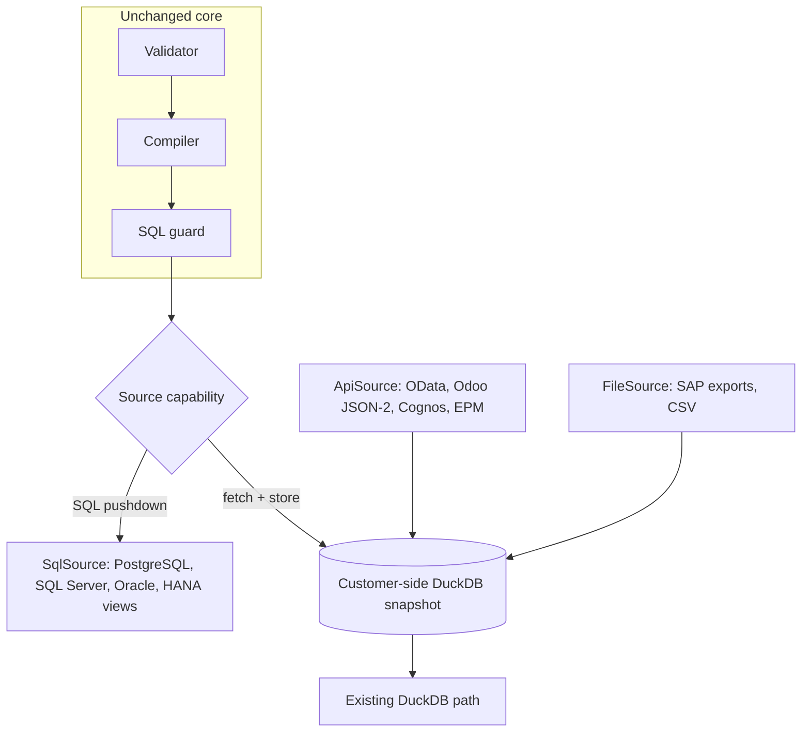

# ERP Integration Analysis

Audit date 2026-10-31, commit `647ef7b`. Labels: **[V]** verified · **[R]** recommendation · **[A]** assumption · **[X]** external source, re-check before committing.

## 1. Conclusion

**Current support for every system in your list is zero.** The only connector is DuckDB (`connectors/duckdb_connector.py`), and tenant config rejects any other type (`tenancy/models.py:30`, probe 17). The one real-world path is a file importer for two SAP list exports (`ingest/sap_exports.py`). [V]

Three points shape the plan:

1. **These systems are not interchangeable.** A database connector does not give application-level meaning, and SAP, Hyperion and Cognos are different layers.
2. **The connector contract is SQL-only.** `Connector.execute(stmt: sa.Select, ...)` (`connectors/base.py:55`) cannot represent OData, BAPI or REST. Those sources need a different path.
3. **The best SAP path for most customers is not "connect to SAP".** It is a customer-owned warehouse or views, because SAP restricts direct extraction and the rules have tightened.

**Recommended order:** finish a PostgreSQL reference connector → the first customer's actual warehouse technology (Q-001) → SQL Server and Oracle → S/4HANA OData → Odoo. Hyperion and Cognos follow only for proven demand. ECC depends on the customer.

## 2. The four categories

| Category | Examples | What it offers | Connection type |
|---|---|---|---|
| ERP application | SAP S/4HANA, SAP ECC, Odoo | Business objects, application security, process rules | OData, RFC/BAPI, JSON API |
| Database | Oracle DB, SQL Server, PostgreSQL | Tables and views, no business meaning | SQL |
| Data warehouse | Warehouse on those engines, HANA, BW, Snowflake | Curated, historical, already joined | SQL or vendor API |
| BI / reporting | IBM Cognos | Reports and semantic models over other sources | REST, or bypass to its source |
| Planning / consolidation | Oracle Hyperion | Financial cubes, planning data | Product REST |

**Hyperion is planning and consolidation, and Cognos is reporting.** Neither is normally the system of record for stock lines. [A: confirm per customer]

## 3. System-by-system

### SAP S/4HANA

| Aspect | Assessment |
|---|---|
| Approach | Published OData APIs and released CDS views; or customer-built CDS views exposed to a warehouse |
| Key interfaces | `API_MATERIAL_STOCK_SRV` (`A_MaterialStock`, `A_MatlStkInAcctMod`) in communication scenario `SAP_COM_0164` for cloud [X]. Product, material document and purchase order APIs for master data, movements and POs [A: confirm names and versions on the SAP Business Accelerator Hub] |
| Requirements | Service activated (on-premises), communication arrangement (cloud), SAP Cloud Connector where required |
| Permissions | Technical user with read-only roles scoped by plant/company code |
| Authentication | OAuth 2.0, X.509 or basic, per SAP configuration; prefer certificate or OAuth |
| Limitations | Designed for transactions, not bulk [X]. Pagination and rate considerations. Not every field is exposed. Licensing of API/digital access must be checked by the customer |
| Difficulty | **High** |
| Mapping | Stock → `stock_balance`, product → `item`/`item_warehouse`, material documents → `inventory_transaction`. Physical stock tables are not the right target in S/4 because stock derives from `MATDOC` [A: confirm per release] |
| In repo | Value maps and canonical fields for SAP export layout only |

### SAP ECC

| Aspect | Assessment |
|---|---|
| Approach | In preference order: (1) existing warehouse/BW extract; (2) customer-built SAP-side service; (3) approved BAPI/RFC; (4) scheduled list exports |
| Requirements | NetWeaver RFC SDK from SAP (S-user) for RFC; ABAP work for custom services |
| Permissions | Dialog-free technical user with narrowly scoped `S_RFC` authorization |
| Authentication | SNC or user/password over a secured link |
| Limitations | `RFC_READ_TABLE`-style generic reads are a poor foundation (field-width limits, broad authorization) [A]. ODP-RFC is not permitted for third parties (below). ECC is end-of-life bound, so limit investment [A: verify customer's support dates] |
| Difficulty | **High** |
| Mapping | Table knowledge exists in the repo's docs: `MARA`, `MARC`, `MARD`, `MBEW`, `MCHB`, `MSEG`/`MKPF`, `EKPO`, `T001W`, `T001L` |
| In repo | **Exports of MB52 and material master only**, with real control-total checks [V] |

**SAP restrictions you must respect [X]:**

- SAP Note 3255746: third-party use of ODP-RFC to access ABAP sources has been **not permitted since February 2024**.
- A vendor technical note reports **June 2026 security patches** blocking unrestricted non-SAP ODP-RFC calls, with a temporary revert option expiring December 2026 (SAP Note 3731818). Secondary source: confirm in the SAP notes.
- That same note says SLT, MDI ABAP adapter, HANA log-based replication and database triggers are also barred for moving data out of SAP.
- SAP points customers to Datasphere for replication into third-party tools, and connectors using published OData are generally considered compliant but slower.
- Direct SQL against HANA under a runtime licence is likely outside its terms. Sources are secondary, so ask the customer's SAP licensing owner and never assume.

**Do not build on ODP-RFC, log replication, or direct tables under a runtime licence.** Have the customer confirm the chosen route in writing.

### Oracle Database

| Aspect | Assessment |
|---|---|
| Approach | Read-only SQL to approved views, ideally on a reporting replica (e.g. Active Data Guard) |
| Requirements | `python-oracledb` thin mode (no Instant Client) [A], network path, TCPS |
| Permissions | Dedicated user, `CREATE SESSION` and `SELECT` on approved views only |
| Authentication | Password from vault; wallet/TCPS; Kerberos if required |
| Limitations | Uppercase identifiers; guard rejects `LOWER`, so search fails (LA-09, probe 10); needs server-side cancel and resource limits |
| Difficulty | **Medium** |
| Mapping | Explicit per view via YAML; Oracle EBS tables if the source is EBS, which needs its own knowledge pack |
| In repo | Design note only |

### Oracle Hyperion

| Aspect | Assessment |
|---|---|
| Approach | EPM Cloud REST: `exportdata` returns a JSON grid; Export Data Slice for Planning [X]. On-premises: product APIs or approved exports, **not verified** in this audit |
| Requirements | Application name, plan type, dimension model |
| Permissions | Read access to the relevant cube slices; only readable cells are returned [X] |
| Authentication | EPM identity (OAuth or basic per configuration) |
| Limitations | Multidimensional, aggregated, no stock lines. Dimensions need separate mapping |
| Difficulty | **High** |
| Mapping | Does not map to `stock_balance`. Add a separate `financial_reference` dataset for valuation reconciliation and budgets |
| In repo | Nothing |
| Priority | **Low.** Useful for reconciling inventory value to finance, not as an inventory source |

### Odoo

| Aspect | Assessment |
|---|---|
| Approach | Version-specific. **External JSON-2 API** for current versions [X]. PostgreSQL read replica only where self-hosted and authorized |
| Requirements | Version check at connect time; API key |
| Permissions | Dedicated Odoo user with read-only access groups |
| Authentication | API key / bearer |
| Limitations | XML-RPC and JSON-RPC deprecated since 19.0; `common` and `object` scheduled for removal in Odoo 22 (fall 2028), Online 21.1 (winter 2027). External API on Odoo Online needs the **Custom plan** [X]. Direct DB access is unavailable on Odoo Online [A] and bypasses Odoo's record rules, so scope must be re-implemented |
| Difficulty | **Medium** |
| Mapping | `stock.quant` → `stock_balance`; `product.product`/`product.template` → `item`; `stock.warehouse`, `stock.location`; `stock.move`/`stock.move.line` → movements; `stock.lot` → `lot`; `purchase.order.line` → purchases. Valuation models vary by version: check per version [A] |
| In repo | Nothing |

### IBM Cognos

| Aspect | Assessment |
|---|---|
| Approach | **Preferred: connect to the warehouse beneath Cognos.** Use Cognos for reconciliation and as a source of business definitions |
| Requirements | Cognos REST API (OData v4-style) for content; instance serves its own reference at `/api/api-docs` [X] |
| Permissions | Service account in the right Cognos role, read on packages/reports |
| Authentication | Session via API; namespace-dependent |
| Limitations | Report output via REST is limited and historically needed the older RDS interface [X]. Data-module export is unverified. Report-based extraction is brittle. Check licensing of API consumers |
| Difficulty | **Medium to high** |
| Mapping | Data modules and Framework Manager models are valuable metadata hints: they tell you which tables and joins the customer already trusts |
| In repo | Nothing |

### SQL Server

| Aspect | Assessment |
|---|---|
| Approach | Read-only SQL to approved views, on an Availability Group secondary where possible |
| Requirements | Microsoft Python driver or pyodbc with ODBC Driver 18 [A], TLS |
| Permissions | User granted `SELECT` on specific views. Avoid blanket `db_datareader` unless the schema is dedicated |
| Authentication | Entra ID or Kerberos preferred; SQL login from vault |
| Limitations | Two compiler/guard defects found: `LOWER` rejected and `NULLS LAST` emitted, which T-SQL does not support (LA-09). Three-part names rejected by the `SourceObject` pattern (`tenancy/models.py:15`) |
| Difficulty | **Medium** |
| Mapping | Explicit per view |
| In repo | Design note only |

### PostgreSQL

| Aspect | Assessment |
|---|---|
| Approach | Read-only role on approved views, replica preferred. **Use as reference connector** |
| Requirements | `psycopg` 3 is already an optional dependency for the app DB [V] |
| Permissions | Role with `SELECT` on views, `default_transaction_read_only=on`, `statement_timeout` set on the role |
| Authentication | SCRAM with TLS, or cloud IAM |
| Limitations | Few. All three sample plans passed compile + guard [V probe 10]; not run on a live warehouse |
| Difficulty | **Low to medium** |
| Mapping | Explicit per view |
| In repo | PostgreSQL verified **only as the app/audit DB**, not as a warehouse source |

## 4. Modular connector architecture



**Principle:** sources that speak SQL push queries down. Everything else lands in an isolated, customer-side snapshot, and the existing engine queries it. This reuses the validated path, avoids writing an OData query compiler, and matches what `ingest/sap_exports.py` already does.

```python
class SourceCapabilities(TypedDict):
    pushdown_sql: bool
    dialect: str | None
    incremental: bool
    metadata: bool
    row_filtering: bool

class Source(Protocol):                       # lifecycle and metadata, all sources
    def capabilities(self) -> SourceCapabilities: ...
    def test_connection(self) -> ConnectionReport: ...
    def assert_read_only(self) -> ReadOnlyProof: ...   # attempts a write, expects failure
    def discover(self, scope: DiscoveryScope) -> SchemaSnapshot: ...

class SqlSource(Source, Protocol):            # today's execute(), with server-side cancel
    def execute(self, stmt: sa.Select, *, fetch_limit: int, timeout_s: float) -> RawResult: ...

class ExtractSource(Source, Protocol):        # API and file sources
    def extract(self, request: ExtractRequest) -> Iterator[RecordBatch]: ...
```

*Illustrative design, not implemented.*

**Conformance suite, required before calling any connector supported:** read-only proof; timeout cancels server-side; `DECIMAL` exactness; date and null handling; bind parameters; guard passes for all plan shapes; pagination stability; pool exhaustion gives a safe error; drift detection; golden totals on a synthetic dataset loaded into a real container of that engine. This extends the checklist already in `02-architecture/CONNECTORS.md`, which is good.

## 5. Practical implications

- **Dialect tests in CI first.** Probe 10 shows that compiling for real dialects reveals defects cheaply. A container-based matrix would catch the rest.
- **Source object names are too restrictive.** The pattern rejects three-part names and SAP namespaces such as `/BIC/...`. [V `tenancy/models.py:15-17`]
- **Source-specific semantics belong in knowledge packs** (SAP, Odoo, Oracle EBS): seed mappings, value maps, reversal rules. See [AI_SCHEMA_DISCOVERY.md](AI_SCHEMA_DISCOVERY.md).
- **Reconcile every onboarding** against the customer's own report (MB52, stock valuation). The tool exists (`/api/admin/reconciliation`) and is one of the best parts of the design.

## Sources

- [Matillion tech note on SAP Note 3255746](https://docs.matillion.com/metl/docs/tech-note-sap-3255746/)
- [Theobald guidance on SAP Note 3255746](https://theobald-software.com/en/?p=53836)
- [SAP Cloud SDK: material stock service](https://help.sap.com/doc/96ad709a1b7e41f3804fa5040bc83167/1.0/en-US/modules/_sap_cloud_sdk_vdm_material_stock_service.html)
- [SAP runtime vs full use, third-party view](https://redresscompliance.com/sap-runtime-vs-sap-full-use-what-enterprise-it-needs-to-know)
- [Odoo External RPC API](https://www.odoo.com/documentation/saas-19.4/developer/reference/external_rpc_api.html)
- [IBM Cognos REST API](https://www.ibm.com/support/knowledgecenter/SSEP7J_11.1.0/com.ibm.swg.ba.cognos.ca_api.doc/c_ca_api_rest.html)
- [Oracle EPM REST: Export Data](https://docs.oracle.com/en/cloud/saas/enterprise-performance-management-common/prest/export_data.html)
- [Oracle EPM REST compatibility](https://docs.oracle.com/en/cloud/saas/enterprise-performance-management-common/prest/compatibility_table_rest_apis.html)
