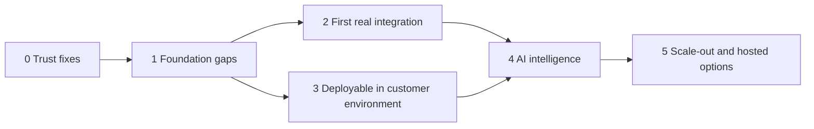

# Product Roadmap

Audit date 2026-10-31. No dates: team size and capacity are unknown. Complexity: **S** days · **M** weeks · **L** a month or more · **XL** a quarter or more, for one experienced engineer, as rough guidance only.

The existing `05-plan/ROADMAP.md` records M1–M10. This one replaces its forward path after the audit.

## What changed from the proposed plan

- **Phase 0 added.** Most of "Foundation" exists, but wrong answers must be fixed before anything else.
- **Phase 1 narrowed** to the gaps; it is mostly built.
- **Enterprise deployment moved earlier.** Running in the customer's environment is what unlocks real data, so it cannot wait until Phase 4.
- **Customer-hosted agent split from it.** A separate agent is deferred until a hosted product is justified.
- **AI intelligence follows a working connector** and a proven mapping.

Phases 2 and 3 run in parallel and must both land before a production pilot.

## Phase 0: Trust fixes

| Item | Detail |
|---|---|
| **Status** | LA-02, LA-03 and LA-04 fixed 2026-10-31 (ISSUES #40–#42). The rest is open |
| **Features** | Fix LA-02 expiry counts, LA-03 failure masking, LA-04 ungrounded text, LA-05 join correctness, LA-14 AVG, LA-15 pool errors, LA-06 safe defaults. Update eslint. Make repo private; settle licence and ownership. Written data-handling terms for existing files (LA-28). Correct stale docs |
| **Dependencies** | None |
| **Complexity** | S to M |
| **Risks** | Other truncated summaries may exist: review every `summary` for the same pattern |
| **Acceptance** | Each summary figure equals independent SQL, tested at low and high limits. Source failure yields an error state, never "nothing stands out". Model text with unverified numbers cannot reach the UI. Duplicate target key fails validation |
| **Testing** | Regression test per defect, written first, including fault injection for dead sources |

## Phase 1: Foundation gaps

| Item | Detail |
|---|---|
| **Already done** | Canonical model, synthetic data, query engine, RBAC core, dashboard, explorer |
| **Features** | Unified scope enforcement; rate limits everywhere; field-level sensitivity for attributes; persistent ABC configuration; assistant coverage of headline questions; SAP-tenant polish; number formatting; scale-capable ABC and Pareto in SQL; item-search endpoint; accessibility pass |
| **Dependencies** | Phase 0 |
| **Complexity** | L |
| **Risks** | Polish absorbing connector time |
| **Acceptance** | Your ten questions: nine or more answered correctly, with obsolescence still honestly refused. ABC runs at 1M items on a test dataset. axe reports no serious violations |
| **Testing** | Generator at scale; eval set expanded; property tests for scope on hand-built queries |

## Phase 2: First real customer integration

| Item | Detail |
|---|---|
| **Features** | Source abstraction; PostgreSQL reference connector; connector for the customer's actual warehouse (Q-001); metadata capture; validation harness (grain, orphans, joins, reconciliation); persistent registry with versions and approval; SAP knowledge pack; onboarding checklist; pilot through more exports (MB51, MARC, MCHB) if live access takes longer |
| **Dependencies** | Phase 0, Q-001…Q-003, written authorization, test environment |
| **Complexity** | XL |
| **Risks** | SAP licensing and extraction limits; slow customer IT; messy data; split valuation |
| **Acceptance** | Connector passes conformance suite. Read-only proven by a failing write. Mapping approved by a named customer person. Reconciliation against the authoritative report passes within agreed tolerance |
| **Testing** | Container matrix per engine. Golden totals. Customer test environment only, never production |

## Phase 3: Deployable in the customer environment

| Item | Detail |
|---|---|
| **Features** | OIDC browser flow (LA-01); Helm or Terraform; runtime configuration; signed images, SBOM, scanning; vault-backed secrets; PostgreSQL audit with retention, tamper evidence, SIEM export; revocable sessions; backups and restore; OpenTelemetry; upgrade and rollback; pen test |
| **Dependencies** | Phase 0, Q-010, Q-012 |
| **Complexity** | XL |
| **Risks** | Customer platform variety; network restrictions; first-time IdP quirks |
| **Acceptance** | Clean install on a customer-like environment from documentation alone. SSO with a real IdP. Group-to-scope mapping verified. Restore drill completed. Independent pen test findings resolved. No deployment path contains dev auth |
| **Testing** | Upgrade from N-1; air-gapped rehearsal; failover; security regression suite |

## Phase 4: AI intelligence

| Item | Detail |
|---|---|
| **Features** | Live provider verification; intent-only mode; metric-level semantic layer; structured composition; real disclosure log; provider, model and region approval record; private endpoint support; model evaluation harness in CI; interpretation chips; cross-warehouse rebalancing; ageing |
| **Dependencies** | Phases 2 and 3; customer AI decision |
| **Complexity** | L to XL |
| **Risks** | Model quality on real terminology; prompt injection; provider terms change; moving aliases |
| **Acceptance** | Agreed routing accuracy on an eval set using the customer's terms. No inventory results sent in intent-only mode, proved by test. Every answer shows provenance, mapping version and model |
| **Testing** | Golden and adversarial evals per model; recorded-response CI; periodic live run on synthetic data |

## Phase 5: Scale-out

| Item | Detail |
|---|---|
| **Features** | Agent + control plane (Model A); hosted SaaS (Model D); additional connectors (S/4HANA OData, SQL Server, Oracle, Odoo, then Cognos, Hyperion); local inference packaged; duplicate item detection; cross-system tenants; price and supplier insights |
| **Dependencies** | Paying demand; repeated deployment pain |
| **Complexity** | XL each |
| **Risks** | Building for customers who do not exist yet; compliance cost |
| **Acceptance** | Per-feature; independent multi-tenant review before shared hosting |
| **Testing** | Isolation tests, chaos tests for agent, connector conformance |

## Before calling it enterprise-ready

All must be true, with evidence:

- Real connector in production use with one customer, reconciled.
- SSO, MFA through the IdP, and scoped RBAC signed off by the customer.
- Independent pen test; findings closed.
- Tamper-evident audit, retention, deletion.
- Vault secrets, encrypted storage, tested restore.
- Monitoring, on-call, incident process.
- Scale test on customer-sized data.
- Security pack: architecture, data-flow, subprocessors, questionnaire answers.
- SOC 2 or ISO 27001 if the target market demands it.
- Support and contract terms.

## Commercial notes

| Question | Position |
|---|---|
| Customer-hosted vs SaaS pricing | Price customer-hosted higher or with a mandatory support fee: support cost per customer is higher. Keep platform fee separate from connector/onboarding fees |
| Onboarding | Paid fixed-scope assessment (metadata + data health report) as the entry point |
| Connector fees | One-off for new sources until demand repeats |
| AI usage | Customer's own endpoint where possible; otherwise a usage pass-through |
| Per-customer forks | Never. Configuration only |

## Top risks

| Risk | Mitigation |
|---|---|
| Polished demo mistaken for a product | State status plainly in every sales conversation |
| Wrong number reaches finance | Phase 0 and reconciliation gates |
| SAP route not permitted | Confirm in writing; prefer warehouse views |
| Key-person risk: one author, 22 commits | Second engineer reviews; handover; owner access |
| Single customer shapes the core | Keep specifics in packs and configuration |
| Data-handling incident during pilot | Customer-side processing, written terms, no real data on laptops |
