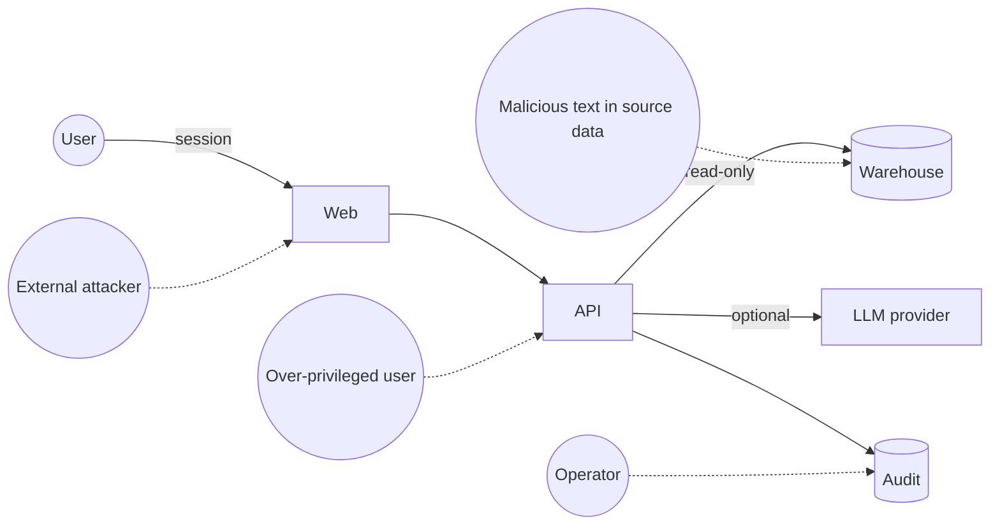

# Security Audit

Audit date 2026-10-31, commit `647ef7b`, synthetic data only. No customer system or real credential was used. Labels: **[V]** verified · **[R]** recommendation · **[A]** assumption.

This is an engineering review. It is **not** a penetration test and gives no certification. Production verdict: **not production-ready**, which agrees with the repo's own `PRODUCTION_READINESS.md`.

> **Update 2026-10-31:** LA-04 is fixed (ISSUES #42). All other findings here remain open.

## 1. Summary

The core authorization design is good and held up under attack. Weaknesses are at the edges: the browser login path for production, the AI boundary, defaults, and enterprise-grade controls that are not built.

### Attempts that failed, in the product's favour [V probes 4, 7, 10; test suite]

| Attempt | Result |
|---|---|
| Restricted user filters another warehouse directly | 403 `forbidden_scope` |
| Same via `below-reorder`, `excess-stock` | 403 |
| `not_in` trick to widen scope | Returned only in-scope warehouses |
| OR-group trick (`warehouse = X OR qty > 0`) | Scope filter is ANDed; only in-scope rows |
| No-cost user reads value via query, ABC, cost comparison, report | 403 |
| No-cost user selects or filters on valuation price | 403 |
| Non-admin reads audit | 403 |
| Export without `export:data` | 403 |
| Insight cache across scopes | Cache key includes tenant, scope and permissions; safe |
| Physical names sent to a model | None found in system prompt or rows |
| Secrets or data files in git history | None found (pattern sweep of all history) |
| API dependency audit | `pip-audit`: no known vulnerabilities, including postgres and redis extras |

## 2. Findings

Priority: **P0** blocks any customer use · **P1** before production · **P2** hardening · **P3** housekeeping.

| ID | P | Finding | Evidence | Fix |
|---|---|---|---|---|
| LA-01 | P0 | **OIDC web path is broken.** Middleware redirects any request without the dev cookie to `/login`. OIDC never sets it, and the browser client sends no `Authorization` header | `apps/web/src/proxy.ts:19`; `lib/api.ts:49-56`; bearer request → `307 /login` [V] | Backend-for-frontend with OIDC code + PKCE and server-side sessions. End-to-end test with a real IdP container |
| LA-04 | P0 | **Unverified model text reaches the user.** If the model answers without calling a tool, invented figures are displayed. `grounding.passed=false` is set but ignored by the UI | `agent/service.py:222,243-246`; `answer-view.tsx:158,202`; probe 6 showed "USD 48,250,000" [V] | Block; replace with a safe refusal |
| LA-06 | P1 | **Insecure defaults.** `Settings()` gives development + dev auth + insecure cookies. Dev login is **username only, no password**. Any deployment that omits env vars is open to impersonation by anyone who can reach it. Only the Dockerfile sets production | `core/config.py:31-35`; `api/auth.py:61`; probe 16 [V] | Default to production-safe; require explicit dev opt-in; bind dev auth to loopback |
| LA-07 | P1 | **AI boundary does not match its documentation** (values not stripped; disclosure log is a count) | `providers.py:405-411`; `service.py:262-272`; `AGENT_DESIGN.md §5`; `THREAT_MODEL.md` T-12 [V] | Intent-only default; content-hash log; correct docs |
| LA-10 | P1 | **Grounding guard is weak.** Spelled-out numbers pass. Provenance numbers (warehouse ids, durations) count as evidence. Numbers in the user's own question count too. Value is checked, meaning is not | `grounding.py`; `service.py:217-221`; probe 5 [V] | See `AI_QUERY_ENGINE_REVIEW.md` |
| LA-11 | P1 | **Rate limiting covers few routes.** Inventory, reports, metrics and `insights?fresh=true` are unlimited. The last runs 32 queries per call | `api/*.py`; probe 14 (6/6 allowed at limit 3) [V] | Apply a per-user budget globally; restrict `fresh` |
| LA-13 | P1 | **Authorization is coarse.** Item master, suppliers and departments are tenant-wide for all readers. Extension attributes cannot be tagged cost-sensitive, so a mapped margin attribute would be readable by no-cost users. Only one sensitivity class. Every user sees physical table/column names in provenance | `validator.py:284-287`; `models.py:78-81`; `resolver.py:67-72`; `query/service.py:277-292`; probe 4 [V] | Field policy classes; item/department scope; show physical names only to a technical permission |
| LA-21 | P1 | **Repository is public with no licence.** Docs describe a live client engagement (file layouts, questions, plans); no client values or name found. Ownership and reuse rights are undefined | GitHub API: `private=false`, no licence [V] | Make private; settle IP ownership |
| LA-28 | P1 | **Real client data handled before consent recorded.** `Q-023` (keep, who sees, deletion) still Open while a real import ran locally | `OPEN_QUESTIONS.md`; `TEST_RUNS` S03-6 [V] | Written terms; confirm disk encryption, deletion date |
| LA-12 | P2 | **Sessions are not revocable.** A logged-out cookie replays until expiry (480 min default). No revocation for bearer tokens either | `api/auth.py:78-81`; probe 15 [V] | Server-side sessions; short tokens |
| LA-15 | P2 | Pool exhaustion raises an unhandled `TimeoutError` (500, not 503) | `duckdb_connector.py:38-45`; probe 9 [V] | Catch `sa.exc.TimeoutError` |
| LA-20 | P2 | **Audit trail is not tamper-evident.** "Append-only" is convention; retention absent; failed logins and logouts are not recorded; no reference to what the question was | `audit/store.py`; `api/auth.py` [V] | Hash chain or WORM; SIEM export; retention |
| LA-22 | P2 | **Supply chain gaps.** No secret scanning, SAST, image scan or SBOM. Actions pinned by tag, base images by floating tag. `pnpm audit` now reports moderate `minimatch` via eslint (dev only), and CI runs it, so the next push will likely fail | `ci.yml`; `pnpm audit` run [V] | Add scanners; pin digests; update eslint |
| LA-23 | P2 | **Container concerns.** Web image bakes API origin; ships dev dependencies; `corepack` may download pnpm at start, breaking air-gapped sites [A: not run, Docker daemon was off] | `apps/web/Dockerfile`; `next.config.ts:5` | Next standalone output; run `node server.js` |
| LA-30 | P2 | **OIDC unknowns.** Tenant chosen from an unverified decode, then fully verified: acceptable. No `nonce` or `azp`/token-type check; assumes groups claim, which Entra can omit for large groups [A] | `auth/oidc.py` [V] | Test with the customer's IdP |
| LA-31 | P3 | Reports preview shows 200 rows to users without `export:data`. Export is a GET, so SameSite=Lax permits cross-site navigation to trigger a download (file goes to the victim) | `api/reports.py:33-40` [V] | Accept or tighten |
| LA-24 | P3 | Security docs are stale in both directions (C-01 "OIDC not started", C-19 "Not started" yet built) | `SECURITY_PLAN.md` [V] | Regenerate from evidence |

## 3. RBAC evaluation

**Enforcement is on the backend and query layer, not merely the UI.** Hiding is cosmetic; API returned 403 when UI controls were bypassed. [V]

| Level | State |
|---|---|
| Tenant | **Yes**: from session, one connector per tenant |
| Department | Indirect: expands to warehouses |
| Warehouse | **Yes**: injected filter, for keyed datasets |
| Dataset | **No**: any `query:run` user can address all mapped datasets |
| Table | Only by mapping |
| Column | **Partial**: `cost` only |
| Operation | **Yes**: 9 permissions |
| Row by item/category/supplier | **No** |
| Source-system permissions inherited | **No** |

**Roles you listed:**

| Role | Today | Gap |
|---|---|---|
| Super administrator | `super_admin` | No separation from business data |
| Department administrator | `dept_admin` with department scope | Cannot administer anything; name misleads |
| Warehouse administrator | Not defined; expressible as a role | Add |
| Standard user | `standard_user` | Includes `cost:read` and `query:run` by default, which is generous |
| Read-only analyst | `viewer_no_cost` is closest | Needs a variant with cost, without export |

Roles are per-tenant YAML, so they are configurable but need a restart and a developer. There is no user store: identity comes from the IdP or dev config.

**Recommended policy model.** Keep the existing approach, but extend it to one structured decision: `allow(subject, action, resource{dataset, field class, scope})`. Add a **separation of duties**: mapping author ≠ approver; an admin who manages roles need not read cost. Hold policy in the database, version it, audit changes.

## 4. Threat model

| Threat | Mitigation present | Residual | Priority |
|---|---|---|---|
| Passwordless dev login exposed | Production guard | Default-off is missing (LA-06) | High |
| Cross-warehouse read | Injection, tests | Master data unscoped (LA-13) | Medium |
| Cross-tenant read | Per-tenant connector; tests | Shared process; needs review before SaaS | Medium |
| SQL injection | No string SQL, bound params, guard | Very low on current paths | Low |
| Write to source | No write path, read-only connection | Real DB depends on the account; test required | Medium until proven |
| Prompt injection via data | Model has no privileged tools; typed args; scope in code | Can distort prose, not access. Needs live testing | Medium |
| Data exfiltration to LLM | Tenant flag | Rows and values sent if enabled (LA-07) | High when enabled |
| Hallucinated figures | Guard partly | LA-04, LA-10 | High |
| Silent wrong totals | Rails, reconciliation | LA-05 fan-out | High |
| Resource exhaustion | Row cap, timeout, limits on some routes | LA-11, no concurrency cap (ISSUES #6) | Medium |
| Stolen session | httpOnly, SameSite, TTL | Not revocable | Medium |
| Audit tampering | Tenant-scoped reads | DB admin can alter | Medium |
| Compromised dependency | Lockfiles, audits | No SBOM, scans, or pinned digests | Medium |
| Credential theft | None stored today | Designed but unbuilt; must be vault-backed | High at first connection |
| Inference by repeated queries | None | Possible with aggregates | Low now |

## 5. What must be true before a real connection

Extending the repo's own pre-connection gate:

1. LA-01, LA-04, LA-06, LA-07 closed. LA-02, LA-03, LA-05 (correctness) closed.
2. Written authorization from Lumiant and the customer, and an approved **test** environment.
3. Read-only account proven by a failing write test.
4. Secrets in a vault; `secret_ref` actually implemented.
5. Independent penetration test before production.
6. Incident contacts, backup restore drill, retention decisions.
